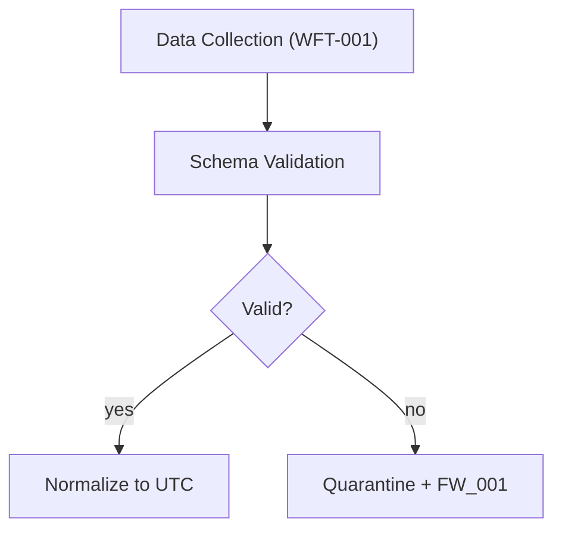
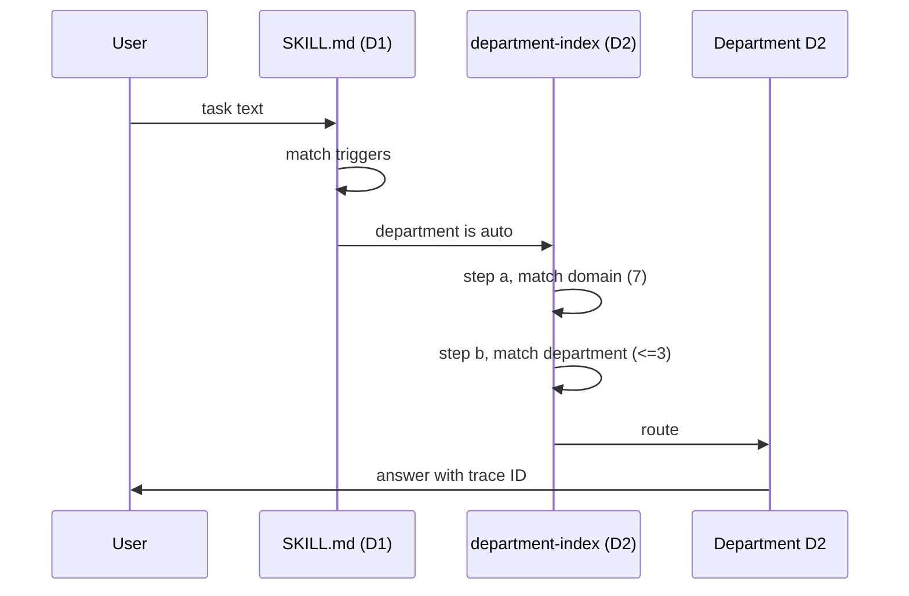
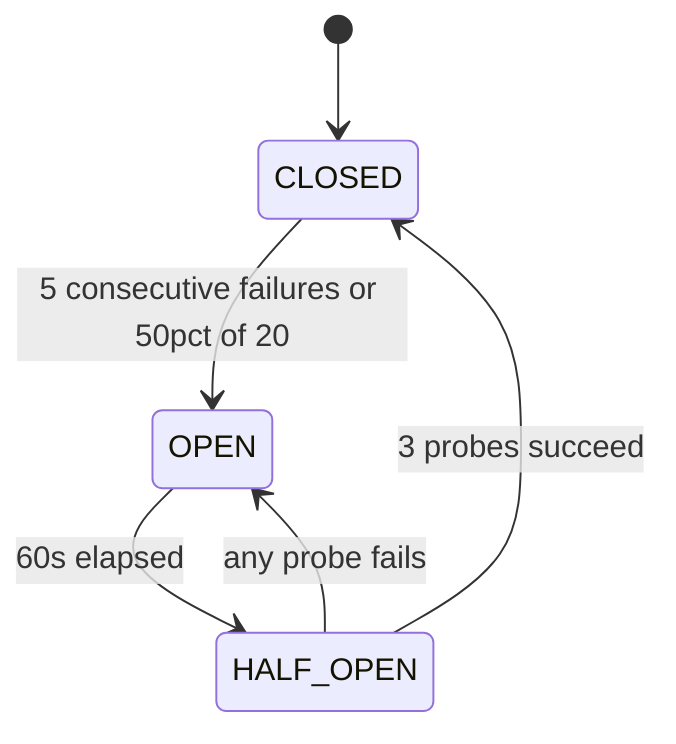
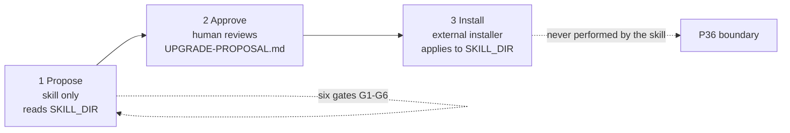

# Mermaid Diagrams

> L3 depth file for [../visualization.md](../visualization.md). Owning department: `quality-visualization`.

## 1. Robustness Rules

These five rules prevent the render failures that account for nearly all broken Mermaid output.

| # | Rule | Failure it prevents |
|---|---|---|
| 1 | **Quote every node label** containing `(`, `)`, `:`, `#`, `,` or a hyphenated slug | Unquoted parentheses terminate the node definition early; the parser then fails on the remainder |
| 2 | Use `ELK` layout for graphs with more than 8 nodes | The default layout produces overlapping edges and unreadable crossings |
| 3 | Never use a reserved word as a node id — `end`, `graph`, `subgraph`, `class`, `state` | Silent parse failure with no useful message |
| 4 | Declare direction explicitly: `flowchart TD` or `flowchart LR` | Ambiguous default varies by renderer version |
| 5 | Keep node ids short and alphanumeric (`n1`, `deptCfo`) | Long or punctuated ids break edge syntax |

Correct form:

Note that `-->|"yes"|` quotes the edge label — the same rule as node labels.

## 2. Diagram Type Selection

| Diagram | Use for | This package's instances |
|---|---|---|
| `flowchart` | Process logic, decision points | Ingestion pipeline, routing |
| `sequenceDiagram` | Inter-department hand-offs, webhook flows | Two-level routing, webhook verification |
| `stateDiagram-v2` | Stateful components | Circuit breaker, branch lifecycle, incident states |
| `classDiagram` / `erDiagram` | Schema and data model | Memory types, model registry |
| `gantt` | Schedules | Rollout phases |
| `journey` | User or task experience | Routing from task to answer |

## 3. Standard Diagrams

### Two-level routing

### Circuit breaker

### Upgrade three-stage model

⚠️ In the third diagram the dashed edge to `x` documents a **boundary**, not a step. The skill
never reaches stage 3 — that is the whole safety property.

## 4. Label Content Rules

| Rule | Reason |
|---|---|
| No unmasked PII in any label | Labels render into exported images that leave the pipeline |
| Error codes written plainly (`FW_001`, not `FW-001`) | Hyphens inside unquoted labels break parsing |
| Percentages written as `50pct` or quoted `"50%"` | The `%` character starts a comment in Mermaid |
| Line breaks via ` ` inside quotes | Raw newlines terminate the node |
| No secrets, tokens or endpoint URLs with credentials | Same masking rule as any output |

## 5. Validation Before Publication

| Check | Action on failure |
|---|---|
| Parses without error | Fix syntax; never publish a diagram that does not render |
| Node count ≤ 20 per diagram | Split into two diagrams |
| Every node reachable from the start | Remove orphans or add the missing edge |
| Edge labels present on every decision branch | A decision with an unlabelled branch is ambiguous |
| Colour not the sole differentiator | Add a shape or text label |

## 6. Constraints

- ❌ Do not leave a label unquoted when it contains parentheses, colons or commas
- ❌ Do not use a reserved word as a node id
- ❌ Do not omit the direction declaration
- ❌ Do not exceed 20 nodes in one diagram
- ❌ Do not put unmasked PII in a label
- ❌ Do not publish a diagram that fails to parse
- ❌ Do not use a bare `%` in an unquoted label
